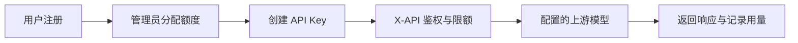

<div align="center">
  
  <h1>X-API</h1>
  <p><strong>你的模型，你的 API 入口。</strong></p>
  <p>管理员分配额度 · 用户管理密钥 · 真实模型接入 · 清晰的调用记录</p>
  <p>
    
    
    
    
  </p>
  <p><a href="#快速开始">快速开始</a> · <a href="docs/x-api/ADMIN.md">管理员指南</a> · <a href="docs/x-api/DEVELOPMENT.md">开发与验证</a> · <a href="UPSTREAM.md">上游来源</a></p>
</div>

---

X-API 是基于 [Sub2API](https://github.com/Wei-Shaw/sub2api) 二次开发的个人 AI API 网关。它把上游模型接入、用户权限、额度和密钥管理放在一个控制台中。

**v0.1 聚焦本地可运行的完整调用流程。** 用户注册后由管理员分配额度，再创建密钥并调用后台提供的实际模型。当前版本不开放自助充值、兑换码、邀请返利或付费套餐。

## 使用流程



## 已有能力

| 用户控制台 | 管理控制台 |
| --- | --- |
| 邮箱密码注册、登录、退出、修改密码 | 用户管理、手动增加或扣减额度 |
| 创建、限额、停用与删除 API Key | 上游账号、模型分组与定价 |
| 查看所在分组的实际模型 ID | 启用与停用上游、并发与速率限制 |
| 查看剩余额度和调用用量 | 调用统计、错误记录与操作审计 |
| 接入指南与请求示例 | 注册策略及站点设置 |

- **普通与流式调用**：第一版重点验证 OpenAI 兼容的 `/v1/chat/completions`。
- **模型目录不造假**：用户模型页与标准 `/v1/models` 只展示所属分组中启用账号的明确模型配置，没有配置时返回空列表。
- **额度由后台分配**：普通用户不能通过直接请求充值、兑换或返利接口增加额度；不是只隐藏前端菜单。
- **独立运行**：使用自己的数据库、Redis、端口与运行目录，不读取旁边 Sub2API 的账号或密钥。

> 站内额度以 USD 记账单位计量，按管理员配置的模型价格扣减；它与火山方舟赠送的 token 数量分别管理。密钥限额只是额外上限，不会增加账户额度。

## 快速开始

### 1. 准备环境

- Go **1.27.2+**（以 `backend/go.mod` 为准）
- Node.js **22+**、pnpm **9+**
- Python **3.9+**
- Docker Engine / Docker Desktop，带 Compose v2

### 2. 初始化并启动

在仓库根目录执行：

```bash
python3 scripts/local.py init
python3 scripts/local.py start
```

首次启动会创建独立数据库、安装前端依赖并编译应用。完成后访问：

**[http://127.0.0.1:18080](http://127.0.0.1:18080)**

管理员邮箱为 `admin@x-api.local`。随机管理员密码保存在 **`.local/environment.json` 的 `ADMIN_PASSWORD`** 中；文件仅当前用户可读，不提交到 Git。

首次进入管理后台，保留了上游的部署与运营说明确认流程，请由实际管理员阅读并确认。这个本地确认不会被启动脚本自动代为接受。

### 3. 配置上游并分配额度

按 [管理员指南](docs/x-api/ADMIN.md) 完成：

1. 创建标准模型分组。
2. 添加上游 API Key、地址和实际模型 ID，关联分组。
3. 设置模型计费价格。
4. 用户自行注册后，进入「用户管理」分配额度。
5. 用户在「API 密钥」创建该分组的密钥，然后调用。

**本仓库不附带可用的供应商密钥。** 豆包需要你在火山方舟开通对应模型并配置自己的 API Key。普通免费 API 额度可以验证中转流程；会员订阅接入仍需后续持有相应账号再单独验证。

### 常用命令

```bash
python3 scripts/local.py status   # 查看应用及数据库状态
python3 scripts/local.py stop     # 停止应用与数据库，保留数据卷
python3 scripts/local.py start    # 再次启动
python3 scripts/local.py build    # 修改代码后重新构建
python3 scripts/local.py restart  # 使用新构建重启
```

| 组件 | 本地地址 / 位置 |
| --- | --- |
| 网页与 API | `127.0.0.1:18080` |
| PostgreSQL | `127.0.0.1:25432` |
| Redis | `127.0.0.1:26379` |
| 配置与运行文件 | `.local/`（已忽略） |
| 应用日志 | `.local/server.log` |
| 构建日志 | 运行构建命令时的终端输出 |

数据库使用 `x-api-local` Compose 项目的持久化卷。`stop` 不删除数据；不要对需要保留的数据执行 `docker compose down -v`。

## 开发与验证

```bash
# 新增模型目录、额度策略，以及账号与密钥相关后端回归
cd backend
go test -tags=unit ./internal/service ./internal/server/middleware \
  -run 'TestXAPI|TestAuthService|TestAPIKeyService|TestGroupModelAllowlist'

# 前端类型检查与关键用户流程
cd ../frontend
pnpm typecheck
pnpm exec vitest run src/__tests__/xapi.spec.ts \
  src/views/__tests__/HomeView.xapi.spec.ts \
  src/views/auth/__tests__/LoginView.spec.ts \
  src/views/auth/__tests__/RegisterView.spec.ts \
  src/views/user/__tests__/KeysView.spec.ts \
  src/views/user/__tests__/ProfileView.spec.ts

# 在仓库根目录运行隔离的端到端 API 验证
cd ..
python3 scripts/smoke.py
```

集成验证使用独立临时数据库、临时 Redis 和本地模拟模型，覆盖注册、权限、分配额度、普通/流式调用、实际扣费、用量记录和密钥停用。测试完成自动清理临时服务，不调用付费模型，也不操作你的正式用户数据。它不替代供应商真实调用验收。

## 项目结构

```text
x-api/
├── backend/          Go 服务、鉴权、调度、计费与迁移
├── frontend/         Vue 用户控制台与管理后台
├── dev/              X-API 独立本地依赖配置
├── scripts/          本地生命周期与隔离集成验证
├── docs/x-api/       X-API 管理和开发说明
├── docs/upstream/    上游 README 与原始仓库记录
├── deploy/x-api/     云端运行镜像、Compose、Nginx 与备份配置
└── .local/           运行时文件与密钥，不进入版本库
```

## 云端部署

支持部署到 **Ubuntu 22.04 / 2 vCPU / 2 GB**：本机交叉编译，服务器运行 X-API、PostgreSQL 18 和 Redis 8，由 Nginx 提供网站入口。包含资源限制、日志轮转、开机自启和每日备份。

```bash
python3 scripts/build-server.py
```

完整安装、更新和恢复步骤见 **[服务器部署指南](docs/x-api/DEPLOYMENT.md)**。`dev/compose.yaml` 仅用于本地；云端使用 `deploy/x-api/`。正式入口为 **[www.liyoh.cn](https://www.liyoh.cn)**，已配置 HTTPS 与证书自动续期；邮件服务与异地自动备份尚待配置。

## 来源与许可证

感谢 [Wei-Shaw/sub2api](https://github.com/Wei-Shaw/sub2api) 提供网关基础。导入提交为 `b0a02a3304a0a78cdd003ddda1dd23ba02c03084`。X-API 保留上游 LGPL-3.0 许可证和来源记录，新增改动通过独立的 Conventional Commits 追踪。

详情见 [LICENSE](LICENSE)、[UPSTREAM.md](UPSTREAM.md)。
